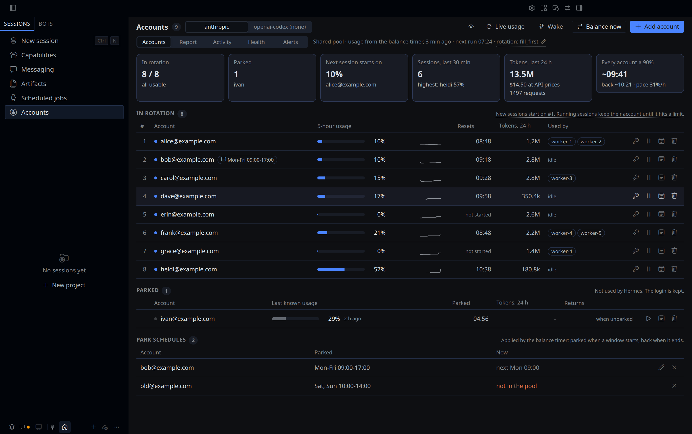
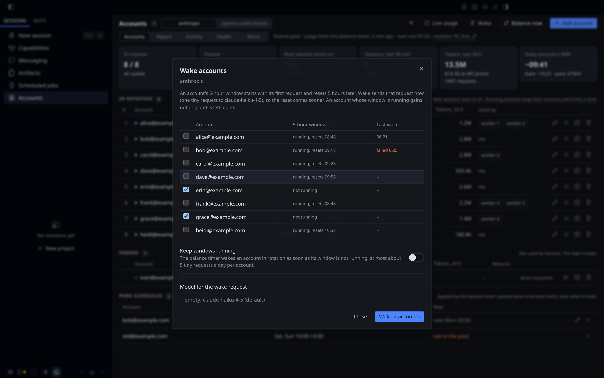
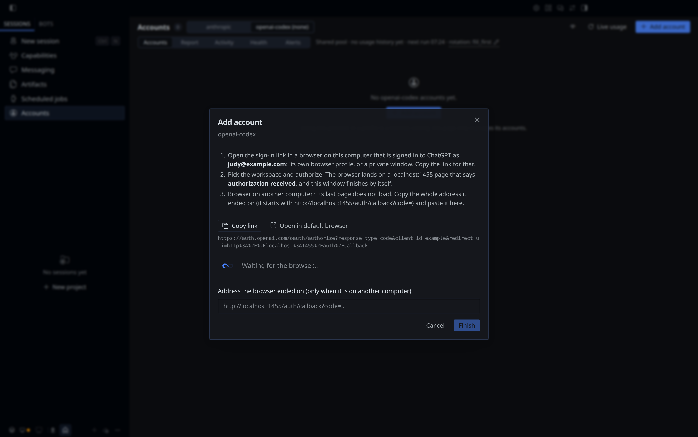

# hermes-account-pool

Run several accounts of one provider in [Hermes Agent](https://hermes-agent.nousresearch.com/docs) and manage them from one command, `hermes account`, or from an Accounts page in Hermes Desktop. Add accounts with a verified email, see live usage per account, spread the load before an account runs out, start an idle account's 5-hour window early, park accounts for a while or on a weekly schedule, see which bot is on which account and how many tokens each bot uses, mask the emails for a screenshot, and get an alert or a daily summary.

Version 3.11.0 · MIT · Hermes Agent ≥ 0.21.5 · Linux with systemd · Indonesian PDF guide in [`docs/`](docs/hermes-account-pool.pdf)



More of the page: [Report](docs/screenshots/report.png) · [tokens by session and load by hour](docs/screenshots/sessions.png) · [Activity](docs/screenshots/activity.png) · [Alerts](docs/screenshots/alerts.png) · [Add account](docs/screenshots/add-account.png) · [Add a Codex account](docs/screenshots/add-account-codex.png) · [Wake](docs/screenshots/wake.png) · [emails masked](docs/screenshots/privacy.png). All screenshots show made-up accounts from the test fixtures.

## Contents

- [Why this plugin](#why-this-plugin)
- [Quick start](#quick-start)
- [Requirements](#requirements)
- [Install, update, uninstall](#install-update-uninstall)
- [Why it is not in the Hermes plugin catalog](#why-it-is-not-in-the-hermes-plugin-catalog)
- [Concepts](#concepts)
- [Adding and removing accounts](#adding-and-removing-accounts)
- [Command reference](#command-reference)
- [Hermes Desktop page](#hermes-desktop-page)
- [Alerts](#alerts)
- [How balance works](#how-balance-works)
- [The timer](#the-timer)
- [Providers](#providers)
- [Files and security](#files-and-security)
- [Security and privacy disclosure](#security-and-privacy-disclosure)
- [Troubleshooting](#troubleshooting)
- [FAQ](#faq)
- [Limitations](#limitations)
- [Contributing, changelog, license](#contributing-changelog-license)

## Why this plugin

Hermes already keeps a pool of accounts per provider and moves a session to the next account when the current one hits a limit. What it does not do on its own:

| You want to | Plain Hermes | With this plugin |
|---|---|---|
| Add an account | `hermes auth add`, no check of which account you actually signed in as | `add` verifies the real email and throws away wrong or duplicate sign-ins |
| See how full each account is | Not shown | `usage`, live, parked accounts included |
| Avoid sessions waiting on a nearly full account | A session waits up to 600 s on a 429, then rotates | `balance` puts the least-used account first and benches accounts at ≥ 90% |
| Take an account out for a few hours | Delete it and sign in again later | `park --until 17:00`, login kept |
| Keep an account free at the same hours every week | Not possible | `schedule <account> --every "mon-fri 09:00-17:00"` |
| Know which bot uses which account | Not shown | `who` |
| Know how many tokens each bot uses, and what that would cost on the API | Not shown | `report`: tokens per account, bot and model, priced at API list prices, and the load per hour for the last 7 days |
| Hear about a dead login or a full pool | Not reported | Desktop and Telegram alerts, and an optional daily summary |
| Recover accounts stuck after a network drop during a token refresh | Waits for the cooldown | Retried automatically every 5 minutes |
| Have an idle account's 5-hour window reset sooner | The window starts with the account's first request | `wake` starts it now; `wake auto-on` keeps every window running |
| Share a screenshot or your screen without the account emails | Not possible | `privacy on`, or the eye button on the page: `al•••e@e•••.com` |
| See all of it in one place | Not shown | The Accounts page in Hermes Desktop |

The plugin changes the pool only through Hermes' own `CredentialPool` API. It uses no AI tokens, except for [`wake`](#wake), which you run or switch on yourself: one tiny request per wake.

## Quick start

```bash
git clone https://github.com/roqianjas/hermes-account-pool.git
cd hermes-account-pool
./install.sh --set-strategy     # both plugins, every profile, the 5-minute timer, fill_first

hermes account anthropic add alice@example.com   # one sign-in per account, verified
hermes account anthropic add bob@example.com
hermes account anthropic doctor                  # everything OK?
hermes account anthropic usage                   # live usage per account
```

Without a git checkout, `hermes plugins install` does the same in three commands ([Install with hermes plugins install](#install-with-hermes-plugins-install)). From then on the timer keeps the pool ordered. Day to day you mostly need `usage`, `who`, `park` and `doctor`. In Hermes Desktop, restart the app once and switch the page on in Capabilities > Plugins to get the same in a page ([Hermes Desktop page](#hermes-desktop-page)).

## Requirements

- Hermes Agent ≥ 0.21.5 on Linux. The timer needs systemd user services (`systemctl --user`).
- Two or more accounts of the same provider. Built-in usage support: Claude Pro / Max / Team (`anthropic`) and ChatGPT Plus / Pro / Team (`openai-codex`). Other providers get the generic commands (see [Providers](#providers)).
- Optional: `notify-send` (package `libnotify-bin`) for desktop alerts, and a Telegram bot configured in Hermes with `TELEGRAM_ALLOWED_USERS` for Telegram alerts.
- Optional: Hermes Desktop with desktop plugins, for the Accounts page. Tested with Hermes Agent 0.21.5 and 0.21.6.

## Install, update, uninstall

A plugin install puts a plugin into one profile. This project needs a little more: the session tracker in every profile (so `who` sees every bot), `account-pool` listed in every profile (so Hermes Desktop can show the page whichever profile it runs) and, if you want it, the timer. `hermes account <provider> setup` does that part, after either way of installing.

### Install from git

```bash
git clone https://github.com/roqianjas/hermes-account-pool.git
cd hermes-account-pool
./install.sh --set-strategy
```

Run it as the user Hermes runs as. `install.sh` copies `account-pool` (with the Hermes Desktop page) and `account-pool-tracker` to `$HERMES_HOME/plugins/` (default `~/.hermes/plugins/`), enables `account-pool` in the default profile, runs `hermes account <provider> setup --yes --timer` for each provider (`--strategy` too with `--set-strategy`), then `doctor`.

| Option | Effect |
|---|---|
| `--provider <name>` | Provider to run `setup` for (default `anthropic`); repeat for several. It matters for `--set-strategy`, which sets `fill_first` for each one. The timer balances every provider with accounts whichever you name. |
| `--set-strategy` | Set `fill_first` for each provider in every profile. Without it the strategy is left alone and `doctor` tells you if it is wrong. |
| `--no-tracker` | Skip the session tracker. `who` stays empty and no tokens are counted. |
| `--no-timer` | Skip the timer. Run `balance` yourself. |
| `-h`, `--help` | Show the options. |

### Install with `hermes plugins install`

The same two folders, straight from this repository, without a git checkout:

```bash
hermes plugins install roqianjas/hermes-account-pool#plugins/account-pool --enable
hermes plugins install roqianjas/hermes-account-pool#plugins/account-pool-tracker --enable
hermes account anthropic setup --timer --strategy
```

Run them in the default profile (without `-p`): the command lives there, and `setup` links the tracker from there into the other profiles ([What setup does](#what-setup-does)).

Hermes scans a plugin from GitHub before it installs it, and stops when the scan has findings. For `account-pool` it reports 12, all expected:

- 11 `subprocess` calls: `notify-send` (desktop alerts), `hermes send` (Telegram alerts), `systemctl --user` five times (timer state for `doctor` and the page, `setup --timer`), `hermes config set` (`strategy`), `hermes auth add` (`add`, `relogin`), `hermes auth remove` (`remove`), and `hermes -p <profile> plugins enable` / `config set` (`setup`);
- 1 read of `/proc/self/cgroup`, to know whether the process is the timer's service.

Each one is in the [Security and privacy disclosure](#security-and-privacy-disclosure). In a terminal, Hermes lists the findings and asks `Install anyway? Only continue if you trust the source. [y/N]`: read them and answer `y`. Without a terminal (a script, an agent's shell) it stops instead; add `--force` there. The tracker has no findings, `hermes plugins update` installs new versions without asking again, and `install.sh` copies the folders itself, so neither is stopped by the scan.

### What setup does

```
$ hermes account anthropic setup --timer
[anthropic] Setup: the default profile and 2 other profile(s) in /home/you/.hermes
  Accounts page    backend listed in 0 of 2 other profile(s)
  Session tracker  1.5.0, active in 1 of 3 profile(s)
  Balance timer    not installed
  Rotation         fill_first in all 3 profile(s)
Changes:
  - list account-pool in plugins.enabled of worker-1 (Hermes Desktop serves the page's backend from there; the profile gets no command and no tools)
  - list account-pool in plugins.enabled of worker-2 (...)
  - link the session tracker into worker-1 (/home/you/.hermes/profiles/worker-1/plugins/account-pool-tracker -> /home/you/.hermes/plugins/account-pool-tracker)
  - enable the session tracker in worker-1 (hermes -p worker-1 plugins enable account-pool-tracker)
  - link the session tracker into worker-2 (...)
  - enable the session tracker in worker-2 (...)
  - install the balance timer: systemd user units in /home/you/.config/systemd/user, every 5 minutes runs hermes account all balance (every provider with accounts, now: anthropic; providers you add later are included by themselves)
Apply these changes? [y/N] y
  done: list account-pool in plugins.enabled of worker-1 (...)
  ...
```

It shows what it found and every change it would make, asks once, then makes them one by one; each one is a line in the [activity log](#log). A second run says `Nothing to change.`

| Part | What setup changes |
|---|---|
| Accounts page | Adds `account-pool` to `plugins.enabled` of every profile under `$HERMES_HOME/profiles/` ([why](#why-every-profile-lists-account-pool)). Profiles get no command and no tools from it. A profile with `account-pool` in `plugins.disabled` is skipped and named. |
| Session tracker | Enables `account-pool-tracker` in the default profile. In every other profile it links `plugins/account-pool-tracker` to the default profile's copy and enables it there with `hermes -p <profile> plugins enable`. One copy means one update for every profile. |
| `--timer` | Writes `hermes-account-balance.service` and `hermes-account-balance.timer` to `~/.config/systemd/user/`, enables the timer and starts a first run in the background. The service runs `hermes account all balance` every 5 minutes: every provider with accounts, so a provider that gets its first account later (Codex, for example) is balanced from the next run, with no second `setup`. A unit from 3.10.2 or older has one line per provider; `setup --timer` for a provider it lacks switches it to `all`. A custom `HERMES_HOME` is written into the service. Options you added by hand (`--threshold 85`) and a changed interval are kept. |
| `--strategy` | Sets `credential_pool_strategies.<provider>: fill_first` in every profile that has another value. `balance` needs it (see [Concepts](#concepts)). |
| `--undo` | Removes the tracker links and the `plugins.enabled` entries in the other profiles, and takes the provider out of the timer: the timer then runs the other providers with accounts, one line each, and no longer picks up new ones; it goes when no provider is left. It keeps both plugins in the default profile, the accounts, parked accounts, settings, data files and strategies, and names parked accounts that would stay out of rotation. |
| `--yes` | No question. Without a terminal (cron, an agent's shell) `setup` shows the plan and changes nothing unless `--yes` is given. |

Every config change goes through `hermes config set` or `hermes plugins enable`, so the files keep Hermes' own format and checks. Without the tracker installed, `setup` says how to install it and leaves that part out. On a system without systemd, `--timer` says so; run `balance` some other way (cron).

A custom `HERMES_HOME` is respected. Running sessions load the tracker after `/reset` or after a gateway or desktop restart. After an update, `doctor` and the Accounts page name each process that still runs the older tracker. The Accounts page needs two more steps in Hermes Desktop, see [Turn the page on](#turn-the-page-on). A profile created later needs `setup` again before Hermes Desktop can show the page while it runs that profile; `doctor` names such profiles.

Check the result:

```bash
hermes account anthropic doctor
systemctl --user list-timers hermes-account-balance.timer
```

### Update

`hermes plugins install`:

```bash
hermes plugins update account-pool
hermes plugins update account-pool-tracker
hermes account anthropic setup        # usually "Nothing to change"
```

Hermes replaces the plugin folder in the default profile. The tracker links in the other profiles point at that folder, so every profile gets the new tracker with one update.

Git install:

```bash
cd hermes-account-pool
git pull
./install.sh                # add the same --set-strategy / --provider options you installed with
```

The previous plugin folder is backed up to `$HERMES_HOME/plugin-backups/<name>.<timestamp>` (outside `plugins/`, so Hermes never loads it twice). Accounts, parked accounts, history and settings are kept. `install.sh` without `--set-strategy` leaves your strategy as it is. Restart Hermes Desktop after any update so it loads the new page and its backend.

### Uninstall

Unpark parked accounts first if you want them back in rotation (`hermes account <provider> unpark <account>`): while the plugin is gone, their logins sit only in `account-pool-parked.json`.

`hermes plugins install`:

```bash
hermes account anthropic setup --undo     # tracker links, page entries, the timer
hermes plugins remove account-pool-tracker
hermes plugins remove account-pool
```

Git install:

```bash
./uninstall.sh
```

It removes the timer, both plugins (the Accounts page included), the tracker symlinks and the `account-pool` entry in each profile's `plugins.enabled`. Your accounts in the credential pool are not touched. Parked accounts are **not** returned to rotation: the script warns you and asks first. Data files and `credential_pool_strategies` stay; the script lists the files you can delete by hand.

## Why it is not in the Hermes plugin catalog

The Hermes plugin catalog lists plugins that never hold a login themselves: OAuth tokens and API keys must come through Hermes (catalog rule 11). `account-pool` handles logins on purpose, because Hermes has no API yet for three of its features:

| Feature | What the plugin does with the login |
|---|---|
| `park` and schedules | moves the account's pool entry, tokens included, into `account-pool-parked.json` and back, and refreshes a parked account's token when it expires |
| `usage`, `balance`, `check`, the email check after a sign-in | sends the account's access token to the provider's usage and profile endpoints |
| **Add account** and **Sign in again** on the Accounts page | runs the provider's sign-in in the page's backend and stores the result in the pool |

Leaving these out would remove the reasons to use the plugin, so it stays outside the catalog and is installed from this repository. What it does with logins is listed in full under [Security and privacy disclosure](#security-and-privacy-disclosure). If Hermes adds pool-level pause and per-account usage reads, the plugin can move onto them and drop its own token handling.

## Concepts

**Credential pool.** Hermes keeps the accounts of each provider in one list in `~/.hermes/auth.json`. Every profile shares it, unless a profile was given its own pool by running `hermes -p <profile> auth add` (`doctor` warns about that).

**Rotation strategy.** Which account a new session takes is a Hermes setting, per profile and provider: `credential_pool_strategies.<provider>`. Hermes owns it. The plugin shows it (`strategy`, the Accounts page header), `doctor` checks it, and it changes it only when you ask: with [`strategy`](#strategy) or from the page. Both write through Hermes' own `hermes config set`.

| Strategy | A new session takes | With this plugin |
|---|---|---|
| `fill_first` (Hermes' default) | the first usable account in the list | **Use this.** `balance` puts the account with the most quota left first, so each new session starts on it. |
| `round_robin` | the next account in turn, which then moves to the end of the list | Fights `balance`: both rewrite the order, and turns ignore how much quota is left. |
| `least_used` | the account this computer picked least often | Counts picks, not quota: use in claude.ai or Claude Code is not seen. |
| `random` | any usable account | The order `balance` sets is ignored. |

`fill_first` plus the balance timer is a rotation by quota: the top spot moves to whichever account has the most room, every 5 minutes. `hermes account <provider> strategy fill_first` and `install.sh --set-strategy` set `fill_first` in every profile.

**Running sessions keep their account.** The order decides where a *new* session starts. A running session stays on its account until that account hits a limit; then Hermes moves it to the next usable account, which `balance` keeps the least used. So the accounts with sessions on them drift down the list as their usage grows, and the top account is usually idle: it is waiting for the next session. A session picks its account again after `/reset`, in a new chat, or after a gateway or Hermes Desktop restart. Moving running sessions earlier would throw away their prompt cache, and resending a long context costs more quota than it saves.

**Account states.**

| State | Set by | In rotation | Ends when |
|---|---|---|---|
| `active` / `ok` | | yes | |
| `BENCHED` | `balance`, at ≥ threshold (90%) | no | the usage window resets, or usage drops under the threshold |
| `LIMITED` / `RATE LIMITED` | Hermes, after a 429 or 402 from the provider | no | the provider's reset time (or 1 hour) |
| `COOLING DOWN` | Hermes, after a failed token refresh (often a network drop) | no | `balance` retries the refresh every 5 minutes |
| `DEAD` | Hermes, when the provider rejects the refresh token | no | you run `relogin` |
| `PARKED` | you, with `park` | no, but the login is kept | you run `unpark`, or the `--until` time passes |

**The 5-hour window.** Claude and ChatGPT limit an account per 5-hour window. The window does not run on a clock of its own: it starts with the account's first request after the previous one ended, and resets 5 hours later. An idle account has no window running, which the page shows as `not started` under **Resets**. [`wake`](#wake) starts it with one tiny request, so it resets sooner.

**Park, bench, remove.** Park is your decision and keeps the login. Bench is automatic and temporary. Remove deletes the login; using that account again needs a new sign-in.

**Adapter.** Usage and real-email lookups need each provider's own API. That code lives in one adapter per provider in [`providers.py`](plugins/account-pool/providers.py). Without an adapter the generic commands still work.

**Default profile only.** The `hermes account` command is installed in the default profile, so worker bots cannot add, remove or reorder accounts. Accounts added from the default profile are shared by every profile. (Every profile lists `account-pool` in `plugins.enabled` for the Hermes Desktop page, but the command and everything else stay in the default profile, see [Why every profile lists account-pool](#why-every-profile-lists-account-pool).)

## Adding and removing accounts

Run these from the **default** profile (no `-p`).

### Add an account

```bash
hermes account anthropic list                 # make sure the email is not in the pool yet
hermes account anthropic add you@example.com
```

1. Answer `y`. Hermes prints a sign-in link.
2. Open the link in a browser that is signed in as **that** account: its own Chrome profile, or a private / incognito window where you sign in. Check that the page says `Logged in as you@example.com`; if not, click **Switch account**. A browser signed in as another account would hand Hermes that account instead.
3. If the page says **"Sign in again to continue"**, that is normal: Anthropic asks for a fresh sign-in when the browser's login is old. Click it and sign in as the same account. Plain `hermes auth add` gets the same page.
4. Authorize, copy the code, paste it into the terminal and press Enter.
5. Look for `Verified: you@example.com` and `Added ...`. The account is balanced right away.
6. Check it: `hermes account anthropic check` (real email) and `hermes account anthropic usage`.

```
$ hermes account anthropic add you@example.com
Add you@example.com to anthropic
  1. Open the sign-in link in a browser that is signed in as THIS account:
     its own Chrome profile, or a private / incognito window.
  2. Make sure the page says: Logged in as you@example.com  (otherwise: Switch account)
     "Sign in again to continue" is normal when that browser login is old.
  3. Authorize, then paste the code back here.
  The account is kept only if the sign-in really is that account and not a duplicate.
Continue? [y/N] y
   ... Hermes sign-in: open the link, authorize, paste the code ...
Verified: you@example.com
Added you@example.com (id=4f1c2a) to anthropic.
```

What `add` can answer:

| Situation | Message | Pool |
|---|---|---|
| Correct sign-in | `Verified ... Added ...` | account added and ordered |
| Browser signed in as another account | `Signed in as X, not you@example.com. The sign-in was discarded.` | unchanged |
| Browser signed in as an account already in the pool | `X is already in the pool as '...' (id=...). The duplicate sign-in was discarded.` | unchanged |
| Email already in rotation | `... is already in rotation. To sign it in again: ... relogin ...` | unchanged, refused before sign-in |
| Email is parked | `... is parked. Return it with: ... unpark ...` | unchanged, refused before sign-in |
| Sign-in failed | `Sign-in did not complete. Nothing was added.` | unchanged |
| You pressed Ctrl+C | `Cancelled (Ctrl+C). Nothing was added.` (exit code 130) | unchanged; a half-saved entry is removed |

After a `discarded` message, switch the browser to the right account (or use a fresh private window) and run `add` again. Running sessions keep their current account; the new account is used from the next session (or after `/reset`).

Options: `--yes` skips the confirmation. `--key` adds an API-key account instead of an OAuth sign-in: the plugin asks for the key without echoing it, so it never shows up on the command line or in `ps`.

### Remove an account

```
$ hermes account anthropic remove bob@example.com
Remove bob@example.com (id=9f2a02) from anthropic.
Its login is deleted; to use it again you must sign in again (add).
To take it out of rotation for a while instead: hermes account anthropic park bob@example.com
Delete it? [y/N] y
Removed bob@example.com.
```

The target can be an email or an id. `remove` refuses the last working account and also deletes parked accounts. To take an account out only for a while, use `park`.

### Avoid

- `hermes -p <profile> auth add`: that profile gets its own separate pool and stops using the shared accounts (`doctor` reports it).
- Plain `hermes auth add`: there is no email check, so labels can be wrong and duplicates can slip in.
- Copying Hermes' tokens to another app or machine: refresh tokens are single use, so one side gets signed out. Signing in to the same account separately in another app is fine.

### Codex

The same commands work for `openai-codex` (ChatGPT Plus, Pro, Business and Enterprise). The sign-in is different: by default it goes through the browser and comes back to this computer, so there is no code to paste.

```bash
hermes account openai-codex list
hermes account openai-codex add you@example.com
```

1. Answer `y`. Hermes prints a sign-in link at `auth.openai.com`.
2. Open it in a browser **on this computer** that is signed in to ChatGPT as **that** account: its own Chrome profile, or a private window where you sign in.
3. Pick the workspace if ChatGPT asks, and authorize.
4. The browser opens `http://localhost:1455/auth/callback?...` and shows **OpenAI Codex authorization received**. That page comes from Hermes on your computer: the sign-in is done and the tab can be closed. The code in its address works only once and is already spent.
5. Look for `Verified: you@example.com` and `Added ...`, then check with `hermes account openai-codex check` and `usage`.

```
$ hermes account openai-codex add you@example.com
Add you@example.com to openai-codex
  1. Open the sign-in link in a browser ON THIS COMPUTER that is signed in to ChatGPT as THIS
     account: its own Chrome profile, or a private / incognito window.
  2. Pick the workspace and authorize. The browser then opens a localhost:1455 page that says
     "authorization received", and the sign-in finishes here by itself.
     Browser on another computer? Use the Accounts page in Hermes Desktop (it takes the
     address the browser ends on), or sign in with a code: add --device.
  The account is kept only if the sign-in really is that account and not a duplicate.
Continue? [y/N] y
   ... Hermes prints the link and waits for the browser ...
Verified: you@example.com
Added you@example.com (id=7c41e0) to openai-codex.
```

**Why the browser and not a code.** ChatGPT Business and Enterprise workspaces turn device-code sign-in off unless an owner turns it on, and OpenAI then answers *"Please contact your workspace admin to enable device code authentication"*. The browser sign-in works either way. It is the same authorization-code + PKCE flow Codex CLI uses, with Hermes' own `hermes auth add openai-codex --browser`. It needs Hermes 0.21.6 or newer; on 0.21.5 `add` falls back to the device code.

**Device code** (`--device`): `hermes account openai-codex add you@example.com --device` shows a code; open `https://auth.openai.com/codex/device`, enter it and confirm. Useful when the browser runs on another computer and you are not using the Accounts page. On a Business or Enterprise workspace an owner first turns on *Settings > Permissions & roles > Codex and Work Local > Enable device code sign-in for Codex* (personal accounts: *Settings > Security*); the setting can take a while to apply.

**Codex CLI and VS Code are not touched.** Hermes creates its own login for the account. `~/.codex/auth.json` and your Codex CLI and VS Code history stay as they are, and signing in here does not sign them out.

**The timer picks them up by itself.** With the balance timer installed, its next run balances the Codex accounts too (usage history, order, benching, alerts): no second `setup`. On a timer from 3.10.2 or older, run `hermes account openai-codex setup --timer` once; `doctor` says so.

**Using the accounts is a Hermes setting.** `add` only puts the account in the pool. A profile uses Codex when its own `config.yaml` says so: as the main model, in `fallback_providers`, or for images (`image_gen.provider: openai-codex`). Check `hermes config` of the profiles if you want to know where Codex quota goes.

## Command reference

```
hermes account <provider> <action> [target] [options]

  list                                  accounts in rotation and parked accounts
  check                                 health: dead, rate-limited, wrong label, duplicate, real email
  usage                                 live usage per account, parked included (adapter)
  who      [--minutes N]                which session is on which account (default 30 min)
  report   [--hours N] [--chart]        load and tokens per account, bot and model, API price;
                                        --chart: load by hour for the last 7 days
  sessions [--hours N]                  the sessions (tasks) with the most tokens, with their API price
  log      [--hours N]                  what the timer, the command and the page changed
  add      <email> [--key] [--yes]      sign in a new account: verified, no duplicates
           [--device]                   openai-codex: a device code instead of the browser
  remove   <target> [--yes]             delete an account's login (parked accounts too)
  park     <target> [--until T]         take an account out of rotation
  unpark   <target>                     return a parked account to rotation
  schedule [<target> --every SPEC]      park an account every week at set hours; no target: list
  unschedule <target>                   remove an account's park schedule
  relogin  <target> [--yes] [--device]  sign an account in again, verified, same label and position
  balance  [--dry-run] [--threshold N]  order by usage, bench >= N% (90), auto-recover, alerts
  strategy [<name>] [--only P,...]      Hermes' rotation strategy per profile: show it, or set it
  doctor                                check strategy, timer, files, pools, alerts
  setup    [--timer] [--strategy] [--undo] [--yes]
                                        profiles, tracker and timer after an install
  notify   [status|test|summary|...]    alert channels (desktop, Telegram) and the daily summary
  wake     [<target>[,...]] [--dry-run] start the 5-hour window of idle accounts now (one tiny request each)
           status|auto-on|auto-off|model=<id>
                                        the setting and every window; the timer keeps windows running
  privacy  [on|off|status]              mask emails in the output, alerts and the page: al•••e@e•••.com
  help                                  show the help

hermes account all balance [--dry-run] [--threshold N]   balance every provider with accounts (the timer)
```

A **target** is an account label (email), its number in `list`, or its id. `unpark` takes a label or id. `hermes account`, `hermes account help`, `hermes account --help` and `hermes account <provider> help` all show the help.

The examples below are based on a real pool, with the accounts renamed. Clock times are illustrative.

### list

```
$ hermes account anthropic list
[anthropic] in rotation (8):
  #1  erin@example.com                   id=12e90b  status=ok
  #2  frank@example.com                  id=025bb6  status=ok
  ...
  #8  heidi@example.com                  id=36c28f  status=ok
[anthropic] parked (1):
  -   ivan@example.com                   id=9e95ee  since 2026-10-10 18:07  until 2026-10-10 21:00
```

The order is the order new sessions take accounts in. Changes nothing.

### check

```
$ hermes account anthropic check
[anthropic] in rotation: 8   parked: 1
  OK #1 id=12e90b  label=erin@example.com
        account : erin@example.com
  ...
  -- parked  id=9e95ee  label=ivan@example.com  (since 2026-10-10 18:07)
  All accounts in rotation are healthy.
```

`account` is the real email reported by the provider (adapter needed). Problems appear as `issue` lines, and the exit code is 1 when any account needs attention.

| Issue | Meaning | Fix |
|---|---|---|
| `DEAD: sign in again` | The provider rejected the refresh token | `relogin <target>` |
| `RATE LIMITED (HTTP 429)` | The provider's own limit | Wait for the reset; Hermes uses other accounts meanwhile |
| `BENCHED by balance` | At or above the threshold | Nothing: released at the reset |
| `COOLING DOWN` | A token refresh failed, usually a network drop | Nothing: `balance` retries it |
| `WRONG LABEL: the real account is X` | The label is not the account that signed in | `relogin` in a browser signed in as the labelled account, or `remove` it |
| `DUPLICATE` | The same account is in the pool twice | `remove <id>` of one of them |

### usage

```
$ hermes account anthropic usage
[anthropic] 5-hour usage
  account                            state     used                          resets
  -- in rotation --
  frank@example.com                  active      2%  [....................]  21:00
  erin@example.com                   active      3%  [....................]  20:10
  dave@example.com                   active      3%  [....................]  21:30
  ...
  heidi@example.com                  active     17%  [###.................]  19:50
  -- parked (not used by Hermes) --
  ivan@example.com                   PARKED     29%  [=====...............]  20:30
```

- The percentages are the same numbers claude.ai shows as "Current session". For `openai-codex` the line ends with both windows, for example `(5h 12% · week 78%)`, and the stricter one is used.
- If the usage endpoint does not answer, the line shows the value the timer recorded last, `(last known, 3 min ago)`, at most 15 minutes old and only while that window has not reset. Otherwise it shows the reason, for example `n/a (usage endpoint rate-limited, retry in a few minutes)`, `n/a (sign-in rejected (401))` or `n/a (usage endpoint unreachable ...)`. API-key entries show `API key: no account usage`.
- Expired access tokens are refreshed first, the same way Hermes does when it uses an account. For parked accounts the new token pair is written back to the parked file at once, because refresh tokens are single use.
- The last line is the [forecast](#forecast): `Forecast (balance timer history): At the last hour's pace (31% of one 5-hour window per hour), every account is at 90% or more around 16:40, until about 17:20 when the first one resets.`

### who

```
$ hermes account anthropic who
[anthropic] sessions active in the last 30 min: 2
  erin@example.com                   (idle)
  frank@example.com                  (idle)
  ...
  heidi@example.com
      worker-2             cli       20261010_181340_51b808 claude-sonnet-5-5    4m ago
      worker-1             cli       20261010_181338_ad9f75 claude-sonnet-5-5    6m ago
```

Columns: profile, platform, session id, model, last API call. `--minutes 120` widens the window. A session that rotated shows `(moved from <account>)`. The data comes from the tracker plugin; a session appears after its next API call.

### report

```
$ hermes account anthropic report --hours 24
[anthropic] usage report: last 24h (288 snapshots, 23.9h covered, from 10-10 06:20)
  'used' adds up 5-hour-window percent: 100 = one full 5-hour window.
  account                              used  share  peak  time >= 90%    tokens     API $
  bob@example.com                       126    27%   60%         0 min     2.7M     $1.53
  carol@example.com                     117    25%   60%         0 min     2.8M     $1.45
  alice@example.com                     112    24%   60%         0 min     3.0M     $1.45
  dave@example.com                      106    23%   60%         0 min     2.5M     $1.23
  total                                 461                               10.9M     $5.66
  Tokens through Hermes: 18.8k input, 252.3k output, 10.1M cache read, 567.8k cache write
  647 requests.
  API $ = these tokens at the provider's API list prices (a subscription is billed flat).
  By profile (bot)                  tokens  requests     API $  share
    worker-1                          5.6M       353     $2.54    51%
    worker-2                          2.4M       136     $1.10    22%
    default                           1.9M       102     $1.72    17%
    worker-3                          1.1M        56     $0.29    10%
  By model                          tokens  requests     API $  share
    claude-sonnet-5-5                 8.0M       489     $3.64    73%
    claude-opus-5-5                   1.9M       102     $1.72    17%
    claude-haiku-4-5                  1.1M        56     $0.29    10%
  Busiest hours: 08:00-09:00 (26), 10:00-11:00 (24), 12:00-13:00 (24)
  Time with EVERY account >= 90%: 0 min
  Forecast: At the last hour's pace (12% of one 5-hour window per hour), the 4 accounts last beyond the next 5 hours.
  Load by hour for the last 7 days: hermes account anthropic report --chart
```

- `used`: the sum of usage increases. 100 equals one full 5-hour window.
- `peak`: the highest value seen. `time >= 90%`: how long the account was nearly full.
- `tokens`: the tokens Hermes sent and received on the account in the period: input, output, cache read and cache write, summed. The two lines under the table split the total and count the requests. The session tracker counts them on every API call from version 1.1.0 on, so a period that starts earlier says `counted since`. `-`: no call counted.
- `API $`: what those tokens would cost at the provider's API list prices, per model (input, output, cache read and cache write each at their own price). A subscription is billed flat, so this is what the use is worth, not a bill. Prices come from Hermes itself: its bundled price list, else its models.dev cache; the plugin makes no request for them. `+` means some tokens have no known price (a model without a listed price, or tokens counted before tracker 1.3.0, which did not record the model); those are left out, not guessed.
- `By profile (bot)` and `By model` split the same tokens by the Hermes profile that made the call and by the model. Tokens counted by a tracker older than 1.3.0 show as `(older tracker, no name)`: they were counted before that update, or by a process that kept the old tracker until it restarted. They leave the report within 8 days.
- `used` and `tokens` measure different things. `used` is the provider's own percentage, which includes the account's use in other apps (claude.ai, Claude Code) and weights token types differently (a cache read costs much less than an output token). `tokens` covers only Hermes on this computer.
- With at least 2 hours of data and some real load, the report adds advice: when every account was ≥ 90% at the same time, it suggests adding an account; when one account carried more than half the load, it points you to `who`.
- The default window is 24 hours (`--hours N`). History covers at least the last 14 days.

`--chart` draws the load per hour for the last 7 days, one row per day, one column per hour (local time). The darker the cell, the more load; `·` is none. The first block is quota used (from the timer's history), the second tokens through Hermes:

```
$ hermes account anthropic report --chart
[anthropic] load by hour (local time; one row per day, one column per hour)
  Load by hour, last 7 days: quota used (5-hour-window percent). Darkest = 26 in one hour.
             00 03 06 09 12 15 18 21
  Mon 10-05  ························
  ...
  Sat 10-10  ······▒██▓█▓██▓▓▓▓█▓▓█▓▓
  Sun 10-11  ▓█▓███░·················
  Load by hour, last 7 days: tokens through Hermes. Darkest = 710.6k in one hour.
             00 03 06 09 12 15 18 21
  ...
```

### sessions

```
$ hermes account anthropic sessions --hours 24
[anthropic] sessions by API price, last 24 h (23 sessions)
  profile              source    tokens requests     API $  title
  worker-1             kanban     12.8M      340    $18.90  Shipping: admin page for limits (t_5f2e91)
  worker-2             telegram    9.5M      272    $12.52  Daily stock digest
  default              desktop     2.1M       61     $4.10  Plan the release
  ...
  20 more: 6.3M tokens, $7.75.
  Total: 30.7M tokens in 801 requests, $43.27 at API list prices.
  Tokens count only the time in this period; the title comes from Hermes' session list.
```

The sessions with the most tokens in the period (15 at most), ranked by API price. Use it to see which task or chat used the tokens a bot shows in `report`, or after a [bot alert](#alerts).

- Tokens per session are counted by session tracker 1.5.0 and later, from its first API call. A period that starts earlier says `counted per session since ...`; until a bot restarts with the new tracker, its sessions are missing here (`doctor` names the processes).
- `title` and `source` (cli, telegram, kanban, cron, desktop, ...) come from Hermes' own session list in each profile's `state.db`, read-only. A session without a title shows its source and id. The Kanban task is added in brackets when the session ran one.
- The same buckets as `report`: 15 minutes, last 8 days. Tokens before the period are left out, so a long session shows only its part inside it.

### log

```
$ hermes account anthropic log --hours 24
[anthropic] activity, last 24 h: 4 events (newest last)
  10-11 08:05  timer  balance     bench alice@example.com (91%) until 10:40
  10-11 09:00  timer  schedule    schedule: parked dave@example.com until 17:00 (Mon-Fri 09:00-17:00)
  10-11 10:12  page   strategy    Rotation strategy [anthropic]: fill_first in worker-3 (was round_robin).
  10-11 10:40  timer  balance     release alice@example.com (12%)
```

What changed in the pool and its settings, and who did it: `timer` (the balance timer), `cli` (a `hermes account` command) or `page` (the Accounts page).

- Logged: bench and release, timed unparks and schedule parks, token refresh recoveries, alerts sent, wakes, `park`, `unpark`, `remove`, `add`, `relogin`, `schedule`, `unschedule`, `strategy`, alert, wake and masking settings. Not logged: reading commands (`list`, `usage`, `report`, ...) and the new order after each balance, which changes on most runs.
- Stored in `account-pool-activity.jsonl`, mode 600, 30 days. Lines hold labels, times and the command's own message, never a credential.

### park and unpark

```bash
hermes account anthropic park frank@example.com                    # until you unpark it
hermes account anthropic park frank@example.com --until 17:00      # today, or tomorrow if 17:00 has passed
hermes account anthropic park frank@example.com --until +2h        # also 90m, 1d
hermes account anthropic park frank@example.com --until '2026-10-12 08:00'
hermes account anthropic unpark frank@example.com
```

Parking moves the account and its login out of the pool into `account-pool-parked.json`. Hermes does not see it, and `usage` still shows its usage. A timed park ends at the first timer run after that time (within 5 minutes). The last working account cannot be parked. Typical uses: keep an account's quota free for your own use in claude.ai, or rest an account that is close to its weekly limit. For the same hours every week, use a [schedule](#schedule-and-unschedule).

### schedule and unschedule

```
$ hermes account anthropic schedule dave@example.com --every "mon-fri 09:00-17:00"
Schedule saved [anthropic]: dave@example.com is parked Mon-Fri 09:00-17:00.
Next: Mon 10-12 09:00.
Unparking it by hand inside a window keeps it in rotation until the next window.
Undo: hermes account anthropic unschedule dave@example.com

$ hermes account anthropic schedule
[anthropic] park schedules: the balance timer parks the account when a window starts and returns it when it ends.
  dave@example.com                   Mon-Fri 09:00-17:00          next Mon 10-12 09:00
Remove: hermes account anthropic unschedule <target>
```

A schedule parks an account on set days and hours, every week. Use it when you work in claude.ai or Claude Code with that account at fixed hours and want Hermes to leave its quota alone then.

- `--every` takes days and a time range in local time. Days: `mon` to `sun`, ranges (`mon-fri`, `fri-mon`), lists (`sat,sun`), `daily`, `weekdays`, `weekend`. A range that ends before it starts runs past midnight: `daily 22:00-06:00`. One schedule per account; saving again replaces it.
- The timer applies it: on its first run after the window starts it parks the account until the window's end, with the same timed park as `park --until`, so it comes back on the first run after the end. `list` and the page mark such a park `(schedule)`.
- Each window is applied once. Unpark the account by hand inside a window and it stays in rotation until the next window. An account you parked yourself is left as it is.
- The last working account is never parked; the timer tries again on its next run.
- `unschedule <target>` removes the schedule. If the schedule has the account parked at that moment, it stays parked until the window ends; `unpark` it to return it sooner.
- Schedules are stored in `account-pool.json` by label, so they survive `relogin`. A schedule whose account was removed shows as `not in the pool` and `doctor` warns about it.

### balance

```
$ hermes account anthropic balance --dry-run
2026-10-10 18:39:48 [anthropic] balance (dry run):
  - order: frank(2%) > erin(3%) > dave(3%) > alice(4%) > carol(5%) > bob(7%) > grace(12%) > heidi(17%)
```

The timer runs `hermes account all balance` (every provider with accounts) every 5 minutes; you rarely need it by hand. `--dry-run` shows the plan without changing anything. `--threshold N` (1 to 100, default 90) sets the bench level. Other lines you may see: `unpark X (park --until ... reached)`, `recovered: X (token refresh retried)`, `bench X (93%) until 17:10`, `release X (40%)`. See [How balance works](#how-balance-works).

### relogin

```bash
hermes account anthropic relogin alice@example.com
```

Signs an OAuth account in again, for example after `DEAD` or `WRONG LABEL`. The new login is added first and its real email checked. If it matches, it replaces the old entry in the same position with the same label. If it does not, the new login is discarded and the old entry is left as it was. Parked accounts must be unparked first. Needs an interactive terminal, where the sign-in link is shown (and, for Anthropic, the code pasted). Ctrl+C cancels cleanly. For `openai-codex` it signs in through the browser like `add`; `--device` uses a device code instead.

### strategy

```
$ hermes account anthropic strategy
[anthropic] rotation strategy per profile (Hermes: credential_pool_strategies.anthropic):
  default                      fill_first
  worker-1                     fill_first
  worker-2                     round_robin
  ...
Balance is built for fill_first: the order it sets decides where new sessions start.
Change: hermes account anthropic strategy <fill_first|round_robin|random|least_used> [--only <profile>,...]

$ hermes account anthropic strategy fill_first
Rotation strategy [anthropic]: fill_first in worker-2 (was round_robin).
New sessions there use it from now; running sessions keep their account.

$ hermes account anthropic strategy round_robin --only worker-2
WARNING: round_robin ignores the order balance sets, so a new session can start on a nearly full account.
Set round_robin in worker-2? [y/N]
```

Shows or sets `credential_pool_strategies.<provider>` in every profile, or only in the profiles given with `--only` (comma-separated). The list also explains the four strategies.

- The value is written with Hermes' own `hermes config set`, one profile at a time, then read back. The rest of each `config.yaml` is left as it was. Profiles that already have the value are not touched; a profile without the setting already uses `fill_first`, so `strategy fill_first` leaves it alone.
- New sessions use the new strategy at once, with no restart: Hermes reads it each time it loads the pool. Running sessions keep their account.
- Anything other than `fill_first` asks for confirmation (`--yes` skips it), because those strategies ignore the order `balance` sets. The output then gives the command that goes back.
- The page does the same from the `rotation: ...` link in its header; see [What the page shows](#what-the-page-shows).

### doctor

```
$ hermes account anthropic doctor
[anthropic] doctor
  OK    strategy fill_first in 6 profiles
  OK    every profile uses the shared account pool
  OK    session tracker active in every profile
  OK    running sessions count with tracker 1.5.0
  OK    Accounts page backend enabled in every profile
  OK    auth.json permissions 600
  OK    account-pool-parked.json permissions 600
  OK    balance timer active, last run 2026-10-10 18:36:09 WIB
  OK    usage history last written 4 min ago
  OK    8 accounts in rotation, 1 parked
  OK    usage endpoint reachable
  OK    alert channels: desktop, telegram via default (delivery is tested with: ...)
  0 failure(s), 0 warning(s).
```

Run it after installing, after a Hermes update, or when bots behave oddly. Every FAIL or WARN line includes the fix. A process loads the session tracker when it starts, so after an update the gateway, Hermes Desktop and long sessions keep the old one; doctor then warns `session tracker 1.5.0 is not loaded yet by: the gateway (...); Hermes Desktop (...)` with the restart each one needs. Tokens without a bot name in the last half hour mean a tracker 1.2.0 or older is still running. A profile on another strategy is a FAIL (`Fix: hermes account <provider> strategy fill_first`); a value Hermes does not know is only a WARN, because Hermes then uses `fill_first`. Exit code 1 when there is a FAIL. For a provider with no accounts it says `not in use, nothing to check`.

### setup

Sets up what a plugin install leaves out: the Accounts page backend and the session tracker in every profile, with `--timer` the balance timer, with `--strategy` `fill_first` everywhere; `--undo` takes the profile and timer parts back. It shows the plan and asks first. See [What setup does](#what-setup-does).

### notify

```bash
hermes account anthropic notify                       # status
hermes account anthropic notify test                  # send a test alert to every channel
hermes account anthropic notify desktop-off           # desktop-on to undo
hermes account anthropic notify telegram-off          # telegram-on to undo
hermes account anthropic notify telegram-via=<profile>  # send with another profile's bot
hermes account anthropic notify daily=08:00           # daily summary at 08:00; daily-off to stop
hermes account anthropic notify summary               # send the summary now
hermes account anthropic notify bots=15               # bot alert from $15 per hour; bots-off, bots-on
```

See [Alerts](#alerts).

### wake

```
$ hermes account anthropic wake --dry-run
2026-10-12 07:04:56 [anthropic] wake (dry run): 3 to wake, 0 failed, 5 left alone.
  - would wake carol@example.com
  - would wake erin@example.com
  - would wake heidi@example.com
  - skip frank@example.com: window running, resets 08:34
  - skip dave@example.com: window running, resets 11:04
  ...

$ hermes account anthropic wake
2026-10-12 07:04:56 [anthropic] wake: 3 woken, 0 failed, 5 left alone.
  - woke carol@example.com (claude-haiku-4-5): its 5-hour window starts now, resets about 12:04
  - woke erin@example.com (claude-haiku-4-5): its 5-hour window starts now, resets about 12:04
  - woke heidi@example.com (claude-haiku-4-5): its 5-hour window starts now, resets about 12:04
  - skip frank@example.com: window running, resets 08:34
  ...
The next balance run (within 5 minutes) reads the new reset times.

$ hermes account anthropic wake auto-on
Automatic wake on [anthropic]: the balance timer wakes an account in rotation whose 5-hour window is not running, with one tiny request to claude-haiku-4-5. At most about 5 a day per account.
```

An account's [5-hour window](#concepts) starts with its first request. An account that sits idle until 10:00 and is then used hard can be full by 11:00 and stays full until 15:00. Woken at 07:00, its window resets at 12:00 instead of 15:00: the work that hit the limit at 11:00 waits one hour, not four. `wake` sends that first request now: one request through the account that asks for a one-word answer.

| Provider | The wake request | How the plugin sees a window that is not running |
|---|---|---|
| `anthropic` | `claude-haiku-4-5`, one output token, through Hermes' own Anthropic client (the same headers and Claude Code identity as a Hermes session) | the usage answer has no reset time |
| `openai-codex` | the smallest model the account offers (from its model list, as Hermes reads it), low reasoning, a one-word answer on the Codex Responses endpoint | 0% with a reset a full 5 hours away, which moves with every reading. The 5-hour window counts, also when the weekly one is fuller |

- **Which accounts.** Accounts in rotation whose window is not running. A running window gains nothing from a wake, so it is left alone, and so are benched, rate-limited, dead, API-key and parked accounts.
- **Without a target** it reads each account's usage first (one usage request per account, as `usage` does) and wakes the idle ones. **With a target** (a label, list number or id, or several separated by commas) it wakes that account unless its window is known to be running, also when its usage cannot be read. `--dry-run` shows what it would do.
- **`wake status`** shows the setting, the model, each account's window from the last balance run and its last wake. It sends nothing.
- **`wake auto-on`** has the balance timer wake an account as soon as its window is not running. Once a window runs, nothing is sent until it ends: at most about 5 requests per account per day. An account woken in the last hour is not woken again, so a wake that did not start a window costs one request an hour, not one every 5 minutes. `wake auto-off` stops it. It needs the timer; `doctor` warns when the timer is off, and when wakes failed in the last 6 hours.
- **`wake model=<id>`** sends the wake to another model; `model=default` goes back to the adapter's choice.
- A failed wake says why (`rate-limited: the account is at a limit, so its window is running already`, `sign-in rejected (401): sign in again`, `model ... not accepted`) and the command exits with 1. Every wake, good or failed, goes into the [activity log](#log).
- **What it does not do.** It adds no quota: the limits stay the same, only the start of the window moves. A pool whose accounts are busy all day has its windows running anyway, so there is nothing to wake.

### privacy

```
$ hermes account anthropic privacy on
Email masking on: the Accounts page, alerts and the output of hermes account show emails as al•••e@e•••.com, for every provider. Targets still take the full email, the list number or the id.

$ hermes account anthropic list
[anthropic] in rotation (8):
  #1  ca•••l@e•••.com                    id=2a1b2c  status=ok
  #2  e•••@e•••.com                      id=4a1b2c  status=ok
  #3  he•••i@e•••.com                    id=7a1b2c  status=ok
  ...
```

For screenshots, screen sharing and pasting output into a chat.

- **The rule.** The first two letters and the last letter of the name (only the first letter for a name of four letters or fewer), the first letter of the domain, and the top-level domain: `alice@example.com` becomes `al•••e@e•••.com`. Enough to tell your own accounts apart, not enough to read them.
- **Where.** Every line `hermes account` prints (columns stay aligned), desktop and Telegram alerts and the daily summary, and the whole Accounts page: tables, cards, dialogs, tooltips, messages and the status-bar chip. The eye button in the page header switches it as well.
- **Display only.** `auth.json`, the activity log, the history and the settings file keep the real emails, so `privacy off` shows them again at once, and `park alice@example.com` still works while they are masked. The page's backend sends the real labels to the page, which masks what it shows.
- `privacy` (or `privacy status`) shows the setting. One setting for every provider (`mask_emails` in the [settings file](#settings-file)).

### Errors and exit codes

Wrong input is refused with a short message:

```
$ hermes account anthropic lst
'lst' is not an action. Did you mean: list?
$ hermes account anthropic usage --hours 5
--hours only applies to: report
$ hermes account anthropic park frank@example.com --until 25:99
Cannot read --until '25:99'. Use HH:MM (e.g. 17:00), +2h, 90m, or 'YYYY-MM-DD HH:MM'.
$ hermes account anthorpic list
Unknown provider 'anthorpic'. Providers in your pool: anthropic. All providers: hermes auth list
```

| Exit code | Meaning |
|---|---|
| 0 | Done |
| 1 | The command ran and found a problem: `check` or `doctor` failures, a discarded or failed sign-in, a refused remove, a confirmation answered with no (or Ctrl+D, or no terminal to answer), `add` or `relogin` without a terminal, `notify test` or `notify summary` reached no channel, `unschedule` of an account without a schedule, a `strategy` or `setup` step that could not be written, a `wake` that failed for an account |
| 2 | Wrong usage: missing or unknown action, provider, target or option |
| 130 | Cancelled with Ctrl+C |

## Hermes Desktop page

`account-pool` also brings an **Accounts** page to Hermes Desktop: the pool, its usage, who is on which account, and the actions of `hermes account`, behind buttons. The command keeps working as before; the page uses the same code.

### Turn the page on

1. Install the plugin and run `hermes account <provider> setup` (or `install.sh`, which runs it). The page comes with `account-pool`; `setup` lists `account-pool` in every profile.
2. Restart Hermes Desktop. The desktop starts the page's backend together with the other enabled plugins, so the page has no data until this restart.
3. In **Capabilities > Plugins**, find **account-pool** (Agent + Desktop; its desktop name is Accounts) and switch on its **Desktop** half. The page ships switched off, so nothing appears until you do.

**Accounts** now appears in the sidebar. The command palette (Ctrl+K, ⌘K on macOS) has `Accounts: open the account pool`, and the status-bar chip opens it too.

### Why every profile lists account-pool

Hermes Desktop runs its backend under the profile you last used (`hermes --profile <name> serve`), and a backend loads a plugin's page routes only when the plugin is in `plugins.enabled` of **that** profile. With `account-pool` in the default profile alone, the page works while Desktop runs the default profile and shows `The account-pool backend did not answer` while it runs any other.

So `setup` (and `install.sh`, which runs it) adds `account-pool` to `plugins.enabled` of every profile. Nothing else changes in those profiles:

- The agent in a profile loads plugins from that profile's own `plugins/` folder, and `account-pool` is not there (no symlink, unlike the tracker). Bots get no command, no tool and no hook from it.
- If a profile ever does load it, `register()` sees the profile and registers nothing. `hermes -p <profile> account ...` stays an unknown command.
- The page's backend always works on the shared pool in the default Hermes home, whichever profile Desktop runs.

`doctor` checks this when Hermes Desktop has the page: `Accounts page backend enabled in every profile`, or a warning naming the profiles that miss it.

### What the page shows

The header has a provider switch (providers with accounts in the pool, plus the two with built-in adapters), the eye button that masks emails, **Live usage**, **Wake**, **Balance now** and **Add account**. The line under it says how old the usage numbers are and when the timer runs next.

| Tab | Content |
|---|---|
| Accounts | The header line shows Hermes' rotation strategy (hover for what each one does, click to change it); a banner names any profile that does not use `fill_first`, with a **Use fill_first** button. Five cards: accounts in rotation, parked accounts, the account the next session starts on with its usage, sessions in the last 30 minutes, tokens in the last 24 hours with their API price. A sixth card is the [forecast](#forecast): when every account will be at 90% or more at the last hour's pace (hover for the details). Then the rotation table in pool order: status, 5-hour usage bar, trend over the last 5 hours, reset time (`back HH:MM` while benched, `not started` while no window runs), tokens in the last 24 hours (hover for input, output, cache, requests, API price, the main model and the current 5-hour window), the profiles using the account (hover for session, platform, model, since when the session is on this account, and the account it moved from) and the row buttons **Sign in again**, **Park**, **Park on a schedule** and **Remove**. A calendar chip next to an account shows its schedule. Parked accounts follow with their last known usage, since when they are parked, when they return (`(schedule)` when a schedule parked them), and **Unpark**, **Park on a schedule** and **Remove**. Then the park schedules, with what each one does now (parked until, next window, or `not in the pool`) and buttons to change or remove it. Active alerts show as a banner on top, a dead account with a **Sign in again** button and a bot alert with **See sessions**. An info banner names any process that still runs an older session tracker, with its fix. |
| Report | The `report` numbers for 24 hours, 3 days or 7 days: load per account, share, peak, time at 90% or more, tokens and their API price, busiest hours and the advice line. Then tokens by profile (bot), by model and by session (the `sessions` list: title, Kanban task, profile, source; hover a title for its accounts, models, times and token split), and a chart of the load per hour for the last 7 days (quota used or tokens; hover a cell for its numbers). |
| Activity | The `log` for 24 hours, 3 days or 7 days, newest first: when, who (`timer`, `cli`, `page`) and what happened. |
| Health | Timer state, age of the usage history, active alerts. **Run doctor** runs the `doctor` checks; **Check accounts** runs `check` and shows its output. |
| Alerts | Desktop and Telegram switches, the profile whose bot sends Telegram alerts, the daily summary (switch and time), the bot alert (switch and dollars per hour), **Send a test alert**, **Send the summary now**, and the alerts active now. |

**Park** asks when the account comes back: when you unpark it, in 1 hour, in 2 hours, or at a time you type (`17:00`, `+90m`, `2026-10-12 08:00`, the same formats as `--until`). **Park on a schedule** asks for the days and the hours (`09:00` to `17:00`), the same as `schedule --every`. **Remove** and **Balance now** ask before they act. Every action reports the same message as the command.

**Wake** opens the wake dialog: every account in rotation with its 5-hour window (`not running`, `running, resets 11:02`) and its last wake. The accounts whose window is not running are ticked; **Wake N accounts** wakes the ticked ones, the same as `wake <id>,<id>`, and shows the result. Accounts with a running window cannot be ticked. **Keep windows running** is `wake auto-on`, and the model field is `wake model=` (empty for the default); **Save settings** appears once you change one. The button reads **Wake: auto** while automatic wake is on.



The **eye button** masks every email on the page (`al•••e@e•••.com`), the same setting as `privacy on`, so it also masks alerts and the command's output. Click it again to show them. The page remembers it, so a reload does not flash the real emails.

**rotation: …** in the header opens the rotation dialog: one picker per profile with its current strategy, an **Every profile** row that sets them all, and what each strategy does. While any profile is off `fill_first` the dialog says why that fights `balance`. **Save** writes only the profiles you changed, the same as `strategy --only`. The banner's **Use fill_first** does the same for the profiles it names, after a confirmation.

The **status-bar chip** reads `8/8 · 12%`: 8 of 8 accounts in rotation are usable, and the account the next session starts on is at 12%. A dot appears when an alert is active (amber) or no account is usable (red). The chip hides while the provider has no accounts or the backend is not loaded.

### Add an account or sign in again from the page

1. **Add account**, type the account's email, **Start sign-in**. For an existing account, use the key button on its row (or **Sign in again** on a dead-account banner); that is `relogin`.
2. **Anthropic**: click **Copy link** and open the link in a browser signed in as that account (its own browser profile, or a private window). Check `Logged in as ...`, authorize, copy the code, paste it into the page and click **Finish**.
3. **Codex** asks how to sign in, **Browser on this computer** (the default) or **Device code**:
   - **Browser on this computer**: click **Copy link**, open it in a browser on this computer signed in to ChatGPT as that account, pick the workspace and authorize. The browser lands on a `localhost:1455` page that says *authorization received*, and the dialog finishes by itself within two seconds. If the browser runs on another computer, its last page does not load: copy the whole address it ended on (`http://localhost:1455/auth/callback?code=...`), paste it into the dialog and click **Finish**.
   - **Device code**: open the page shown, enter the code; the dialog finishes by itself once you confirm. ChatGPT Business and Enterprise workspaces often turn this off (see [Codex](#codex)).
4. The result is the same as on the command line: `add` keeps the sign-in only when the email matches and the account is not in the pool yet, then balances; `relogin` swaps the new login in at the same position only when it is the same account.



**Open in default browser** is there too, but your default browser is often signed in as another account; **Copy link** into the right browser profile is the safe way. A sign-in that is not finished within 15 minutes expires, and **Cancel** drops it at once. Each sign-in can be finished only once. A sign-in OpenAI refuses (you clicked *Cancel* there, or the link expired) takes the dialog back to its first step, with the email kept.

While a Codex browser sign-in waits, the page's backend listens on `127.0.0.1:1455`, the only address OpenAI sends the browser back to. It answers only that sign-in (any other `state` gets *Not this sign-in*) and stops listening when the sign-in finishes, is cancelled, or after 15 minutes. One Codex browser sign-in waits at a time: starting a second one ends the first. When another program holds the port (a Codex CLI login, or `hermes auth add openai-codex --browser` in a terminal), the dialog says so and takes the pasted address instead.

### Requests to the provider

| You | Requests |
|---|---|
| Open the page, switch tabs, look at the chip | None. Usage comes from the history the timer writes every 5 minutes, tokens from the tracker, API prices from Hermes' own price list. |
| Live usage | One usage request per account, parked accounts included. At most once every 2 minutes per provider; the button counts down. |
| Balance now | The same as `balance`. At most once a minute, shared with Check accounts. |
| Check accounts | One profile request per account. |
| Wake | One usage request per ticked account, then one tiny model request per account whose window is not running. At most once a minute, shared with Balance now and Check accounts. |
| Eye button, wake settings | None. |
| Run doctor | One usage request. |
| Add account, Sign in again | The sign-in, then one profile request to verify the email. |

The usage endpoint limits requests per account (see [Troubleshooting](#troubleshooting)), so the page never calls it on its own.

### How the page is built and secured

- The page is the plugin's `desktop/plugin.js`, a Hermes Desktop plugin. It imports only the Hermes plugin SDK and React, and talks only to its own backend.
- The backend is `dashboard/plugin_api.py`, mounted by Hermes under `/api/plugins/account-pool/` when `account-pool` is in `plugins.enabled` of the profile Desktop runs. Hermes requires the desktop's session token for every request.
- Responses carry labels, ids, states, percentages and times. Tokens never leave the backend. The state of a sign-in in progress (the PKCE verifier for Anthropic and for the Codex browser sign-in, the device id for the Codex device code) stays in the backend's memory.
- The page always works on the shared pool in the default Hermes home, whichever profile the window shows. Bots cannot use it: it is part of the desktop app, not a tool.
- One action runs at a time; a second click while one runs gets `Another account action is still running`.

## Alerts

| Alert | When | Sent |
|---|---|---|
| Account needs sign-in | An account becomes `DEAD` | Once per account |
| Every account above 80% | Every account in rotation is at or above 80% (adapter needed) | Once, plus a message when the pool recovers |
| A bot uses far more than usual | A profile's last hour reaches $15 at API prices or 300 requests, and 3 times its usual hour | Once per bot, at most every 6 hours |

The bot alert catches a loop or a runaway task before it eats the pool:

```
Hermes: worker-1 is using far more than usual
Last hour: $20.00 at API prices, 100 requests, 5.0M tokens, 20x its usual $1.00 per active hour.
Busiest session: Shipping: admin page for limits (kanban, task t_5f2e91, 100 requests).
Check: hermes account anthropic sessions --hours 1
```

- Usual = the mean of the profile's active hours (hours with at least one request) in the 7 days before. Until a profile has 3 active hours there is no usual yet, and the floor counts double ($30 or 600 requests).
- Both conditions must hold, so a bot that is always busy does not alert, and a quiet bot that doubles its small use does not either.
- A bot near the floor goes over and under it from one timer run to the next. It gets one message per 6 hours (`alert_bot.cooldown_h`); the page shows the banner whenever it is over.
- Counted from the tracker's files, with no request to the provider. Tokens without a bot name are left out. The busiest session needs tracker 1.5.0.
- `notify bots=25` changes the dollar floor (and turns the alert on), `notify bots-off` turns it off. The request floor, the factor and the cooldown are `alert_bot.requests`, `alert_bot.factor` and `alert_bot.cooldown_h` in the [settings file](#settings-file).

Alerts are sent by `balance`, so they need the timer. Channels:

- **Desktop**: `notify-send`, on by default.
- **Telegram**: on automatically when Hermes has a Telegram bot. The message goes with `hermes send` to the first user in `TELEGRAM_ALLOWED_USERS` (your private chat), using the default profile's bot. If the default profile has no working bot, use another profile's: `notify telegram-via=<profile>`.

Run `notify test` after setting up.

### Daily summary

`notify daily=08:00` sends a summary of the last 24 hours once a day, on the first timer run after 08:00, to the same channels as the alerts. There is one per provider, and only for a provider with something to report: requests counted, usage above 0%, or an account that needs a new sign-in. A provider whose accounts sat idle all day sends none. Turned on after that time, the first one comes the next day. `notify summary` sends one at once, which is also a preview.

```
Hermes anthropic: last 24 h
Tokens: 10.9M in 647 requests, $5.66 at API list prices.
Bots: worker-1 5.6M, worker-2 2.4M, default 1.9M, worker-3 1.1M.
Share of the load: bob 27%, carol 25%, alice 24% and 1 more. Highest 5-hour usage: 60% (bob). Every account >= 90% at once: 0 min.
Busiest hour: 08:00-09:00.
Now: 4 in rotation, 0 parked; new sessions start on alice (59%).
```

Accounts that need a new sign-in and the report's advice are added when there are any, plus the [forecast](#forecast) when the pool had load in the last hour and the session with the highest API price. The summary is built from the plugin's files, with no request to the provider. `notify daily-off` stops it.

### Settings file

Settings are stored in `$HERMES_HOME/account-pool.json`, created on the first change. You can also edit it; the alert level is `alert_all_above`, the daily summary time `notify.daily`, the bot alert `alert_bot` (`usd` per hour, `requests` per hour, `factor` over the usual hour, `cooldown_h` between two messages for the same bot), park schedules are under `schedules`, automatic wake and the wake model per provider under `wake`, and email masking is `mask_emails`:

```json
{"notify": {"desktop": true, "telegram": "auto", "telegram_via": "default", "daily": "08:00"},
 "alert_all_above": 80,
 "alert_bot": {"on": true, "usd": 15, "requests": 300, "factor": 3, "cooldown_h": 6},
 "schedules": {"anthropic": [{"label": "dave@example.com", "id": "a3b2c3", "days": [0, 1, 2, 3, 4], "from": "09:00", "to": "17:00"}]},
 "wake": {"anthropic": {"auto": true}, "openai-codex": {"auto": false, "model": "gpt-6-luna"}},
 "mask_emails": true}
```

### Forecast

`usage`, `report`, the daily summary and the Accounts page say when every account will be at 90% or more if the pool keeps the last hour's pace:

```
Forecast: At the last hour's pace (31% of one 5-hour window per hour), every account is at 90% or more around 16:40, until about 17:20 when the first one resets.
```

- The pace is the sum of every account's usage increases in the last hour, from the timer's history. Nothing is requested from the provider.
- The forecast spends that pace minute by minute on the least-used account below 90%, the way `balance` and `fill_first` hand out new sessions, and gives an account its headroom back when its window resets. It looks one window length ahead (5 hours for Anthropic).
- It assumes accounts of the same plan (the percentages add up) and a steady load; a bot that starts or stops changes it within the hour. Read it as "at this pace", not as a promise.
- With less than 25 minutes of recent history, or no account with a known usage, there is no forecast. With no load in the last hour it says so.

## How balance works

`hermes account <provider> balance` balances one provider; `hermes account all balance`, which the timer runs, does it for every provider with accounts (in rotation or parked), one after the other. A provider that fails does not stop the others; the exit code says that one did.

Each run, for one provider:

1. **Timed parks**: unparks accounts whose `--until` time has passed (schedule windows that ended included).
2. **Schedules**: parks accounts whose schedule window has started, until the window ends.
3. **Recovery**: retries the token refresh for accounts in a refresh cooldown.
4. **Usage** (adapter needed): reads every account's usage, refreshing expired access tokens first.
5. **Bench and release**: accounts at or above the threshold are benched until their window resets; benched accounts that dropped below it are released. Benches are marked `[account-pool]`, and limits set by the provider itself are never touched.
6. **Order**: least used first, then benched accounts, then accounts whose usage could not be read, then `DEAD` accounts.
7. **Wake** (only with `wake auto-on`): one tiny request through each account in rotation whose 5-hour window is not running, from the usage read in step 4. See [`wake`](#wake).
8. **History**: one snapshot per run for `report` and for the `last known` fallback. Values taken from that fallback are never written back.
9. **Alerts** for new problems (an account that needs sign-in, every account high, a bot far above its usual use), and the daily summary when it is due.
10. **Activity log**: every change from steps 1 to 9 goes to `account-pool-activity.jsonl` (see [`log`](#log)).

Safety rules:

- If **every** account is at or above the threshold, only accounts at 100% are benched, so the pool is never emptied for being nearly full.
- If no usage can be read at all, the order is left unchanged. Recovery, timed unparks, schedules, alerts and the daily summary still run.
- Running sessions are not moved. Moving a session to another account would throw away its prompt cache.

Why benching at 90% helps: when an account hits its limit, Hermes retries once and can wait up to 600 seconds before rotating. Benching just before the limit means new sessions start on an account with room.

## The timer

```bash
systemctl --user list-timers hermes-account-balance.timer           # status and next run
journalctl --user -u hermes-account-balance.service -n 20 -o cat    # recent runs
systemctl --user start hermes-account-balance.service               # run now
systemctl --user disable --now hermes-account-balance.timer         # stop
systemctl --user enable --now hermes-account-balance.timer          # start again
```

- **Interval**: `systemctl --user edit --full hermes-account-balance.timer`, change `OnUnitActiveSec=5min`. Every run reads each account's usage once, so do not go much below 5 minutes.
- **Threshold**: `systemctl --user edit --full hermes-account-balance.service`, add `--threshold 85` to the `ExecStart` line.
- **Providers**: the timer runs `hermes account all balance`, so every provider with accounts is balanced, including one that gets its first account later. On a unit from 3.10.2 or older (one `ExecStart` line per provider), `doctor` warns about a provider with accounts that the timer misses; `hermes account <provider> setup --timer` switches the unit to `all`.
- **Only some providers**: replace the `all` line with one line per provider (`ExecStart=... account anthropic balance`), or run `hermes account <provider> setup --undo` for the one to leave out.
- **Remove**: `hermes account <provider> setup --undo` with only that provider left removes the timer; `systemctl --user disable --now hermes-account-balance.timer` stops it at once.

The timer uses no AI tokens unless you turn on automatic wake (`wake auto-on`): it calls the usage endpoints and, for alerts and the daily summary, your notification channels. With automatic wake it also sends one tiny model request when an account's window is not running.

## Providers

| Feature | Providers |
|---|---|
| `list`, `check`, `add`/`remove`, `park`/`unpark` (also `--until`), `schedule`, `who`, tokens and API price, `doctor`, sign-in alerts, daily summary, refresh-cooldown recovery | **Every provider in the credential pool** (OAuth and API-key entries) |
| `relogin` | Every provider with OAuth sign-in. Email verification needs an identity adapter. |
| `usage`, `report`, usage-based `balance`, `wake`, "all accounts high" alert, real-email lookup | **Providers with an adapter.** Built in: **`anthropic`** (Claude Pro / Max / Team, 5-hour window) and **`openai-codex`** (ChatGPT Plus / Pro / Team, 5-hour **and** weekly window). |

Without an adapter, `usage` and `report` say so plainly, and `balance` still unparks timed parks, retries refresh cooldowns and sends sign-in alerts, but leaves the order unchanged.

**Codex.** The stricter of the 5-hour and weekly limits drives `balance`, and `usage` shows both (`5h 12% · week 78%`). A Codex account that is also signed in to Codex CLI or VS Code shares its quota with them. Hermes keeps its own Codex sign-in and never reuses `~/.codex/auth.json`.

**The plugin only manages accounts inside a provider.** Whether a profile uses a provider at all (main model, fallback order) stays a normal Hermes setting, and the plugin never changes it. A provider with no accounts yet is idle: `hermes account openai-codex doctor` says "not in use".

Adding an adapter for another provider is a single class; see [CONTRIBUTING.md](CONTRIBUTING.md).

## Files and security

| Piece | Role |
|---|---|
| `plugins/account-pool/` | The `hermes account` command (`__init__.py`) and the provider adapters (`providers.py`). The command registers in the default profile only. |
| `plugins/account-pool/desktop/` | The Accounts page for Hermes Desktop (`plugin.js`). Hermes Desktop copies it to `$HERMES_HOME/desktop-plugins/account-pool/`. |
| `plugins/account-pool/dashboard/` | The page's backend (`plugin_api.py`) and its manifest. `dist/index.js` only tells the browser dashboard that the page lives in Hermes Desktop. |
| `plugins/account-pool-tracker/` | A `post_api_request` hook that records `{profile, session, platform, model, account label, tracker version, process id, Kanban task}` and adds each call's token counts to its account, profile and model. No commands, no tools, no credentials; it swallows every error so it can never break a bot. |
| `plugins/account-pool-tracker/README.md` | The tracker's own page: what it records, and why it needs in-process plugins. |
| `install.sh`, `uninstall.sh` | Install and remove from a git checkout. `install.sh` copies the plugins and runs `setup`; the systemd units are written by `setup`. |
| `docs/screenshots/` | Screenshots of the Accounts page, taken by `tests/ui/screenshots.mjs` from a Hermes Desktop that shows the test fixtures. |

Data files, all mode `600`, in `$HERMES_HOME`:

| File | Content |
|---|---|
| `account-pool-parked.json` | Parked accounts. **Contains OAuth tokens.** |
| `account-pool-sessions.json` | Sessions and their account, last 24 hours (no tokens) |
| `account-pool-tokens.json` | Token counts per account, profile and model, and per profile, session and model, in 15-minute buckets, last 8 days. Numbers and session ids only. |
| `account-pool-activity.jsonl` | The activity log: what the timer, the command and the page changed. Last 30 days, mode 600. |
| `account-pool-history.jsonl` | Usage snapshots, one per timer run. Trimmed to the last 14 days once the file passes 3 MB. |
| `account-pool-alerts.json` | Alerts already sent, so each incident is reported once |
| `account-pool-state.json` | When the daily summary was last sent, which schedule windows were already applied, and each account's last wake (time, model or the reason it failed) |
| `account-pool.json` | Settings: alert channels, daily summary, park schedules, wake, email masking |

How tokens are handled:

- Tokens are never printed or logged. They only go into request headers to the provider's own endpoints.
- The plugin talks to the provider's API (usage, profile, token refresh, sign-in, and the wake request when you use `wake`) and, for alerts and the daily summary, to Telegram through Hermes' own `hermes send`. Nothing else. API prices come from files Hermes already has.
- The Accounts page gets no tokens: its backend returns labels, ids, states and numbers only.
- Refresh tokens can be single use. Every refresh is written back at once, under a file lock for parked accounts.
- API keys for `add --key` are read without echo inside the plugin, never from the command line.
- The repository's `.gitignore` excludes `*.json`, `*.jsonl` and `.env`, so state files cannot be committed by accident.

## Security and privacy disclosure

What the plugins do outside their own files, in one place: what you should know before you run them. It follows the disclosure the [Hermes plugin catalog rules](https://hermes-agent.nousresearch.com/docs/developer-guide/plugins/catalog-submission) ask for (rule 13), although the plugin is not in the catalog ([why](#why-it-is-not-in-the-hermes-plugin-catalog)).

**It writes credentials.** Managing accounts is the point of `account-pool`, so unlike a read-only plugin it changes logins in Hermes' credential pool (`$HERMES_HOME/auth.json`):

- `add`, `relogin`, `remove`, `park`, `unpark`, `schedule` and `balance` change the pool through Hermes' own `CredentialPool` API (`load_pool`, `add_entry`, `remove_index`) or through `hermes auth add` and `hermes auth remove`. Nothing edits `auth.json` as text.
- `park` moves an account's pool entry, OAuth tokens included, into `account-pool-parked.json` (mode 600, written under a file lock) and `unpark` moves it back. While an account is parked, `balance` refreshes its access token when it expires, with Hermes' own refresh functions (`refresh_anthropic_oauth_pure`, `refresh_codex_oauth_pure`), and writes the new tokens back at once, because refresh tokens can be single use.
- `add` and `relogin` in a terminal run `hermes auth add` (for Codex with `--browser --no-browser`, or without them for `--device`). **Add account** and **Sign in again** on the Accounts page run the same OAuth flows in the page's backend, with Hermes' own client ids and token functions: the PKCE code flow at `claude.ai` for Anthropic; for Codex the PKCE browser flow at `auth.openai.com` with its callback on `127.0.0.1:1455`, or the device code flow. The PKCE verifiers and the device id stay in the backend's memory for at most 15 minutes.
- `add --key` reads an API key without echo and stores it through the pool API.
- **It sends model requests only for `wake`.** Each wake is one request through the account, with a one-word answer: for Anthropic through Hermes' own client (`build_anthropic_client`: `claude-code/<version> (external, cli)`, `x-app: cli`, and the Claude Code system line Hermes sends with every subscription request); for Codex on the Codex Responses endpoint with the headers below. It runs when you run `wake`, click **Wake**, or, after `wake auto-on`, from the timer. Nothing else in either plugin calls a model.
- Usage and profile requests send the same client headers as Hermes' own usage fetcher: `User-Agent: claude-code/2.1.0` with `anthropic-beta: oauth-2025-04-20` for Anthropic, `codex_cli_rs/0.0.0 (Hermes Agent)` with `originator: codex_cli_rs` for Codex. Without them Anthropic rate-limits the usage endpoint far sooner.
- It uses these Hermes internals, checked against Hermes 0.21.5: `hermes_cli.auth_commands` (`_OAUTH_ADD_SPECS`, `_unsuppress_provider_sources`, `_normalize_provider`, `auth_add_command`, `auth_remove_command`), `agent.anthropic_credentials` (`_OAUTH_CLIENT_ID`, `_OAUTH_REDIRECT_URI`, `_OAUTH_SCOPES`, `_generate_pkce`, `_post_oauth_token`, `_oauth_token_state`, `refresh_anthropic_oauth_pure`), `hermes_cli.auth_codex` (`CODEX_OAUTH_CLIENT_ID`, `_codex_request_device_code`, `_codex_exchange_authorization_code`, `_codex_http_client`, `_codex_base_url`, `refresh_codex_oauth_pure`), `hermes_cli.auth_codex_browser._codex_browser_exchange_code` (Hermes 0.21.6 and newer; without it the plugin posts the same token request itself), `agent.codex_headers.codex_account_headers`, `agent.anthropic_adapter` (`build_anthropic_client`, `_CLAUDE_CODE_SYSTEM_PREFIX`) and `hermes_cli.codex_models.get_codex_model_ids` for `wake`, `hermes_cli.auth` (`PROVIDER_REGISTRY`, `_utc_now_z`, `mark_provider_active_if_unset`), `agent.credential_pool` (`load_pool`, `PooledCredential`), `hermes_constants` (the Hermes home and its per-profile override), `hermes_cli.secret_prompt.masked_secret_prompt`, `hermes_cli.config.set_config_value`, and `agent.usage_pricing` (`_lookup_official_docs_pricing`, `resolve_billing_route`) with `agent.models_dev._load_disk_cache` for API prices. A Hermes update that changes them breaks the affected command with an error; it cannot corrupt the pool, because every write still goes through the pool API.
- Tokens are never printed, logged, returned to the page, or sent anywhere but the provider's own endpoints.

**Network.** Only these, and only when a command, the timer or a page button asks:

| Host | What | When |
|---|---|---|
| `api.anthropic.com` | `/api/oauth/usage`, `/api/oauth/profile` | `usage`, `check`, `balance` (every 5 minutes with the timer), the email check after a sign-in, **Live usage**, **Run doctor** |
| Anthropic's OAuth token endpoint, through Hermes' `_post_oauth_token` | code exchange, token refresh | page sign-in, refresh of parked accounts |
| `claude.ai/oauth/authorize` | the sign-in link you open yourself | page sign-in |
| `api.anthropic.com/v1/messages` | one tiny request per wake (`claude-haiku-4-5`, one output token) | `wake`, **Wake**, and the timer after `wake auto-on` |
| `chatgpt.com/backend-api/wham/usage` | Codex usage | as for Anthropic usage |
| `chatgpt.com/backend-api/codex/responses`, `.../codex/models` | one tiny request per wake; the account's model list, to pick the smallest model | as for the Anthropic wake |
| `auth.openai.com` | the sign-in link you open yourself; device code, token exchange and refresh | Codex sign-in, refresh of parked Codex accounts |
| Telegram, through `hermes send` | alerts and the daily summary | when an alert fires or the summary is due, if Telegram alerts are on |

There is no telemetry, no update check and no other host. Opening the page or switching tabs makes no request at all.

**Local listener.** Only during a Codex browser sign-in started on the Accounts page, the page's backend listens on `127.0.0.1:1455` (loopback only, not reachable from other computers) for the browser's return from OpenAI. It accepts only the sign-in it was started for and closes when that sign-in ends, is cancelled, or after 15 minutes. `add` and `relogin` in a terminal leave the listener to `hermes auth add`.

**Background work.** Nothing runs on its own unless you install the timer (`setup --timer`, or `install.sh` without `--no-timer`). The timer is a systemd user unit that runs `hermes account all balance` every 5 minutes, for every provider with accounts: it reads every account's usage, reorders the pool, benches and releases accounts, applies timed parks and schedules, retries token refreshes and sends alerts. After `wake auto-on` it also wakes accounts whose 5-hour window is not running (at most about 5 tiny requests per account per day). The tracker runs inside every Hermes process that loads it, as a `post_api_request` hook (see its [README](plugins/account-pool-tracker/README.md)).

**Commands it runs.**

| Command | Why |
|---|---|
| `systemctl --user` | timer state for `doctor` and the page; `setup --timer` and `--undo` install, start and remove the units |
| `notify-send` | desktop alerts |
| `hermes config set` | `strategy`, `setup` (`plugins.enabled`, `credential_pool_strategies`) |
| `hermes plugins enable account-pool-tracker` | `setup`, once per profile |
| `hermes auth add`, `hermes auth remove` | `add`, `relogin` and `remove` in a terminal |
| `hermes send` | Telegram alerts and the daily summary |

**Reads outside its own files.** Every profile's `config.yaml` (strategy and plugin lists), every profile's `state.db` read-only (session titles for `sessions`), `/proc/self/cgroup` (whether the process is the timer's service, so the activity log says `timer` rather than `cli`), `/proc/<pid>/cmdline` of Hermes processes (`doctor`: which process still runs an older tracker), Hermes' price files, and the state of the systemd units. `hermes plugins validate` lists the `/proc/self/cgroup` read as a `caution`; that is all it is for.

**Writes outside its own files.** `auth.json`, as above. `config.yaml` of the profiles, only through `hermes config set` and `hermes plugins enable`, only from `setup`, `strategy` and the page's rotation dialog. The tracker links `profiles/<name>/plugins/account-pool-tracker`. The systemd units in `~/.config/systemd/user/`.

**Who can use it.** The command registers in the default profile only, so bots in other profiles cannot run it, and it registers no tools. The page is part of Hermes Desktop and its backend requires Desktop's session token. One account action runs at a time.

## Troubleshooting

| Symptom | Likely cause | Fix |
|---|---|---|
| `usage` shows `n/a (usage endpoint rate-limited ...)` or `last known` | The usage endpoint was queried very often in a short time (by this plugin, other usage tools, or Hermes Desktop's model picker). This is the measuring endpoint, not your model quota. | Wait a few minutes. Bots are not affected, and `balance` keeps accounts without data after the others. |
| Sign-in page says "Sign in again to continue" | The browser's login is old (Anthropic policy) | Click it and sign in as the same account |
| `add` says `discarded` | The browser was signed in as another account, or as one already in the pool | Use that account's own Chrome profile or a fresh private window, then run `add` again |
| `Cancelled (Ctrl+C). Nothing was added.` | You pressed Ctrl+C during sign-in | Expected. Run `add` again when ready. |
| A bot says "retrying in 600s" | Its account hit a 429 before `balance` benched it | `hermes account anthropic balance`, then stop and resend the message in that session |
| `check`: `DEAD` | Login revoked, or the token was used by another app or machine | `hermes account anthropic relogin <email>` |
| `check`: `WRONG LABEL` or `DUPLICATE` | Added with plain `hermes auth add` while signed in as another account | `relogin` the right account, or `remove <id>` the extra entry |
| `sessions` lists nothing | The bots still run a tracker older than 1.5.0 | `hermes gateway restart`, restart Hermes Desktop; `doctor` names the processes |
| `who` is empty | Sessions started before the tracker was installed, or Hermes runs plugins with `plugins.isolation: host` | `/reset` the session, or restart the gateway or desktop. Under `host` isolation the tracker cannot see the account (see [Limitations](#limitations)) |
| `doctor`: session tracker X is not loaded yet by ... | The gateway, Hermes Desktop or a long session started before the tracker was updated | `hermes gateway restart`; restart Hermes Desktop; a session switches when it ends |
| No Telegram alert | The bot token of the sending profile is invalid | `notify test`; switch with `notify telegram-via=<profile>` |
| `report`: not enough history | The timer is off or was just installed | `doctor`, then wait for a few runs |
| A `--until` park did not end | The timer is off | `hermes account <provider> setup --timer` |
| A schedule did not park its account | The timer is off, it is the last working account, or you unparked it by hand inside the window | `hermes account <provider> schedule` shows the state of each schedule |
| No daily summary | The timer is off, no alert channel is on, it was turned on after its time today, or the provider had nothing to report (no requests, no usage, no account to sign in again) | `notify` shows the time and the last day it was sent; `notify summary` tests delivery |
| `doctor`: `the balance timer does not run openai-codex` | The timer unit is from 3.10.2 or older and has one line per provider | `hermes account openai-codex setup --timer` (switches it to every provider with accounts) |
| `report`: `API $` shows `-` or ends in `+` | The model has no price in Hermes' price list, or the tokens were counted before tracker 1.3.0 | Nothing to fix; those tokens are left out of the price |
| `doctor`: strategy is not fill_first | A profile uses `round_robin` or another strategy | `hermes account <provider> strategy fill_first`, or **Use fill_first** on the page |
| `doctor`: profiles with their OWN pool | Someone ran `hermes -p <profile> auth add` | Remove those entries in that profile (`hermes -p <profile> auth remove ...`) and add the accounts from the default profile |
| `doctor`: last run failed | The timer's last `balance` failed | `journalctl --user -u hermes-account-balance.service -n 20` |
| `hermes account`: unknown command | Run with `-p <profile>`; the plugin is in the default profile only | Run it without `-p` |
| Accounts page: `The account-pool backend did not answer` | Hermes Desktop runs a profile that does not list `account-pool` (a profile created after the install, or an install older than 3.5.1), or was not restarted after the install | `hermes account <provider> setup`, then restart Hermes Desktop. `doctor` names the profiles that miss it |
| `add needs a terminal` or `relogin needs a terminal` | It ran from cron, an agent's shell or another place without a terminal, where nobody can paste the sign-in code | Run it in a terminal, or use **Add account** / **Sign in again** on the Accounts page |
| `no terminal to answer, so no` | A command that asks first ran without a terminal | Run it in a terminal, or add `--yes` |
| `setup`: session tracker not installed | Only `account-pool` was installed | `hermes plugins install account-pool-tracker --enable`, then `setup` again |
| No Accounts entry in the sidebar | The Desktop half of the plugin is off | Capabilities > Plugins, account-pool, switch on Desktop. After an update: Ctrl+K, `Reload desktop plugins` |
| Live usage button greyed out | Live usage ran less than 2 minutes ago | Wait for the countdown on the button |
| Sign-in in the page: `This code belongs to another sign-in` | The code came from another sign-in link, or was copied without the part after `#` | Open the link from this window again and copy the whole code |
| Codex: *"Please contact your workspace admin to enable device code authentication"*, **Continue** greyed out | The ChatGPT workspace turned device-code sign-in off | Sign in without `--device` (the default), or pick **Browser on this computer** on the page. Or have an owner turn on *Enable device code sign-in for Codex*, which can take a while to apply |
| Codex: the browser ends on a `localhost:1455` page that does not load | The browser runs on another computer than Hermes, or the sign-in in Hermes already ended | Page: paste that whole address into the dialog. Terminal: use the page, `--device`, or the SSH tunnel Hermes prints |
| Codex page sign-in: `Port 1455 on this computer is taken` | A Codex CLI login or `hermes auth add openai-codex --browser` is waiting on the port | Finish or stop that one, or paste the address the browser ends on |
| Codex: `OpenAI refused the sign-in` or `Token exchange failed` | You cancelled on OpenAI's page, or the link was older than a few minutes | Start the sign-in again |
| Codex: `This address belongs to another sign-in` | The pasted address came from an older sign-in link | Open the link from this dialog again and paste the address it ends on |
| `wake failed ...: model ... not accepted` | The account's plan does not offer the wake model | `hermes account <provider> wake model=<id>` with a model the account offers, or `model=default` |
| `wake failed ...: rate-limited` | The account is at a limit, so its window is running already | Nothing to fix; the next run finds the window running |
| **Resets** shows `not started` | No 5-hour window is running on that account | Normal for an idle account. **Wake** starts it if you want it to reset sooner |
| Automatic wake does nothing | The timer is off, or every window is already running | `hermes account <provider> wake status`; `doctor` |
| Emails show as `al•••e@e•••.com` | Email masking is on | `hermes account <provider> privacy off`, or the eye button on the page |

## FAQ

**My quota in claude.ai (or another usage tool) is fine. Why does `usage` say rate-limited?**
Two different limits. Your model quota is what the bots spend. The usage endpoint that tools read to *display* that quota has its own request limit. When it is hit, only the display is affected: bots keep running, and the plugin shows the last known value.

**Does the plugin use AI tokens?**
Only for `wake`, and only when you run it or switch on `wake auto-on`: one request with a one-word answer per wake, which leaves the window at 0%. Everything else reads usage and reorders the pool without calling a model.

**Should I turn on automatic wake?**
It helps a pool with idle hours: an account that waits for work has its window running already, so it resets sooner once the work comes. It costs at most about 5 tiny requests per account per day. A pool that is busy around the clock gains little, because its windows run anyway. It adds no quota.

**Does masking hide the emails from the files?**
No. It masks what is shown: the command's output, alerts and the page. The files keep the real emails, so that targets and `privacy off` keep working.

**Does `balance` move running sessions to a less used account?**
No. A running session keeps its account until it hits a limit; moving it would discard the prompt cache. New sessions take the least used account.

**Why are the accounts in use in the middle of the list, and #1 idle?**
That is balance working. A session started on the account that was #1 at the time. Its usage grew, so the next runs moved fresher accounts above it. #1 is where the next new session starts. See [Running sessions keep their account](#concepts).

**Is there a round-robin mode?**
Hermes has one (`round_robin`), next to `fill_first`, `least_used` and `random`; the plugin has no mode of its own. You can switch with `strategy` or on the page, but with this plugin keep `fill_first`: balance then rotates by quota left instead of by turn. The table under [Concepts](#concepts) compares the four.

**Does the plugin change my fallback provider or models?**
No. Fallback, models and which provider a profile uses stay in your Hermes configuration. The only model-related setting the project writes is `credential_pool_strategies`, and only when you ask: `setup --strategy`, `install.sh --set-strategy`, `hermes account <provider> strategy`, or the page's rotation dialog. `setup` also writes `plugins.enabled` of each profile, for the page and the tracker.

**Can I use the same account in claude.ai, Claude Code or Codex CLI at the same time?**
Yes, with a separate sign-in there. The quota is shared, so that use shows up in `usage`. Never copy Hermes' tokens to another app or machine.

**What happens if the provider changes the usage endpoint?**
`usage`, `report` and usage-based ordering stop, `doctor` reports FAIL, and Hermes' built-in rotation keeps working as before.

**Can a worker bot run `hermes account`?**
No. The command is installed in the default profile only, on purpose. Bots run the tracker, which only records which account they use and how many tokens they spent on it.

**Why does an account show many tokens but a low percentage, or the other way round?**
The percentage is the provider's, for everything on the account, weighted by token type. Most of what Hermes sends is cache reads, which count for little. Use against Claude Code or claude.ai raises the percentage without adding Hermes tokens.

**Is `API $` what I pay?**
No. A subscription (Claude Pro, Max or Team, ChatGPT Plus, Pro or Team) costs the same however much you use it. `API $` prices the same tokens as if they had gone through the provider's API, so you can see what the subscription is worth and which bot costs the most.

**How many accounts do I need?**
At least two. `report` tells you when the whole pool was nearly full at the same time, which is the signal to add one.

## Limitations

- Usage comes from **undocumented endpoints**: `https://api.anthropic.com/api/oauth/usage` and `https://chatgpt.com/backend-api/wham/usage` (the one behind Codex CLI's `/status`). They can change or rate-limit without notice. The plugin sends the same client headers as Hermes' own usage fetcher.
- Anthropic weekly quotas are not exposed for Team accounts, so `balance` uses the 5-hour window for `anthropic`.
- `wake` relies on what the usage endpoints show today: Anthropic gives no reset time while no window runs, Codex shows a full untouched window that moves with every reading. If a provider changes that, `wake` cannot tell an idle window and leaves the account alone (a named account is still woken). A wake is a request made with the account like any Hermes session, so it falls under the same plan terms.
- Email masking covers what the plugin shows. Other places that show account labels, such as `hermes auth list` or Hermes' own logs, are not masked.
- Adapters exist for `anthropic` and `openai-codex`. The generic commands were tested for other providers with API-key entries only. Codex was verified with a real ChatGPT Business account: the browser sign-in, `check`, `usage`, `who`, `report`, `sessions`, `log`, `doctor` and `balance --dry-run`. Park, unpark, the parked-token refresh, balance and the page's sign-ins were tested in a sandbox with fake tokens (`tests/codex_sandbox.py`, `tests/api_sandbox.py`).
- Token counts start when tracker 1.1.0 first runs and cover Hermes on this computer only. They are kept for 8 days, in 15-minute buckets, so a period starts at the nearest quarter hour. The split by profile and model starts with tracker 1.3.0; bots pick up a new tracker when their gateway or session restarts.
- `API $` uses list prices for the standard context length; long-context surcharges and batch discounts are not applied.
- `who` finds the agent object by scanning running thread frames, because Hermes' `post_api_request` hook does not name the pool entry a call used. That needs Hermes' default `plugins.isolation: in_process`: under `host` isolation the tracker records nothing, so `who`, token counts, the session list and the bot alert stay empty, while usage, balance, park, schedules and the forecast keep working. A future Hermes refactor may also leave `who` empty, but it can never break the bots.
- Both plugins are built for Hermes' default `plugins.isolation: in_process`. Under `plugins.isolation: host`, Hermes does not register plugin CLI commands, so `hermes account` is not there (the timer's `balance` included), the tracker records nothing, and the Accounts page backend runs in the plugin host, where it has not been tested. Switch back with `hermes config set plugins.isolation in_process`.
- `add` and `relogin` need a terminal (or the Accounts page) to show the sign-in link, paste the code or type the key. Without one they stop at once with the command to run, instead of waiting for input.
- The Codex browser sign-in needs the browser on the computer that runs Hermes (or the Accounts page, which takes the pasted address). OpenAI accepts only `http://localhost:1455/auth/callback` as the return address for the Codex client, so the port cannot be changed.
- The Accounts page follows the Hermes Desktop plugin SDK as of Hermes Agent 0.21.5. A future SDK change can break the page; the command is not affected.
- Linux with systemd only, for the timer. The commands themselves work wherever Hermes runs.

## Contributing, changelog, license

- Adapters for more providers are welcome. [CONTRIBUTING.md](CONTRIBUTING.md) covers the adapter interface, the rules for handling tokens, the Hermes Desktop page, and how to test in a sandbox without touching your real pool.
- [CHANGELOG.md](CHANGELOG.md) lists every release.
- [`docs/hermes-account-pool.pdf`](docs/hermes-account-pool.pdf) is the full guide in Indonesian. `docs/make_doc.py` regenerates it (reportlab, DejaVu fonts).
- License: MIT, see [LICENSE](LICENSE).
