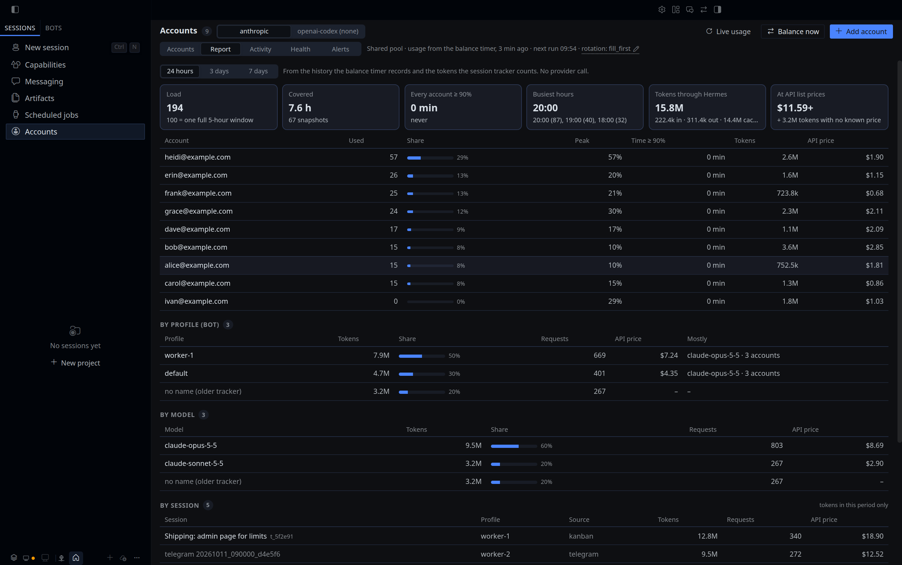

# account-pool-tracker

The session tracker of [hermes-account-pool](https://github.com/roqianjas/hermes-account-pool). It records which account of a Hermes credential pool each session is on, and how many tokens each account, bot, model and session used. On its own it does nothing you can see: the [`account-pool`](../../README.md) plugin reads what it writes for `hermes account <provider> who`, `report`, `sessions`, the bot alert and the Accounts page in Hermes Desktop.

Version 1.5.0 · MIT · Hermes Agent ≥ 0.21.5



## Install

The tracker has to run in every profile whose bots you want to see, because Hermes loads plugins per profile. Install it in the default profile and let `account-pool` link it into the others:

```bash
hermes plugins install account-pool --enable
hermes plugins install account-pool-tracker --enable
hermes account anthropic setup            # links and enables the tracker in every other profile
```

From a git checkout, `./install.sh` does the same. Running sessions load the tracker after `/reset`, the gateway after `hermes gateway restart`, Hermes Desktop after a restart; `hermes account <provider> doctor` names every process that still runs without it or with an older version.

## What it records

One `post_api_request` hook. After each API call it looks up the running agent of the session, reads which pool entry the call used (label and id only), and writes two files in the default Hermes home:

| File | Content | When |
|---|---|---|
| `account-pool-sessions.json` | profile, session, platform, model, account label, since when on that account, tracker version, process id, Kanban task | Once per session per minute, or at once when the session's account changes. Kept 24 hours. |
| `account-pool-tokens.json` | input, output, cache read and cache write tokens and 1 request, added to a 15-minute bucket per account, profile and model, and per profile, session and model | Every call. Kept 8 days. |

Both files are mode 600 and hold labels, ids and numbers only. The tracker never reads or writes a credential, sends nothing over the network, registers no command and no tool, and swallows every error, so it can never break a turn. A call that went to another provider (a fallback) is not counted against the pool's account.

## Known issue: in-process plugins only

Hermes' `post_api_request` hook does not say which pool entry a call used. The tracker finds it by scanning the running threads for the agent of the session (`sys._current_frames()`) and reading its `_credential_pool`. That works with Hermes' default `plugins.isolation: in_process`. Under `plugins.isolation: host` the hook runs in another process, finds no agent and records nothing, so `who`, the token counts and the session list stay empty for those processes. Everything in `account-pool` that does not depend on the tracker (usage, balance, park, schedules, forecast, the "every account high" alert) keeps working.

A field naming the pool entry in the hook's arguments would remove the frame scan; that is a request for Hermes, not something this plugin patches.

## Files

- `__init__.py`: the hook (`register(ctx)` registers `post_api_request`).
- `plugin.yaml`: the manifest.

The full guide, including how the numbers are used and priced, is the [hermes-account-pool README](../../README.md).
